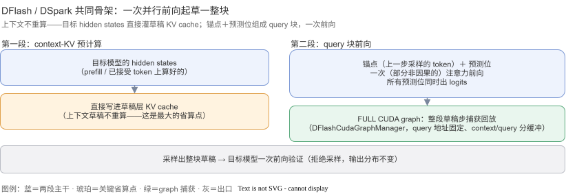
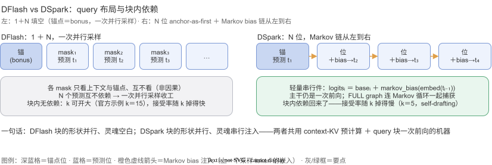
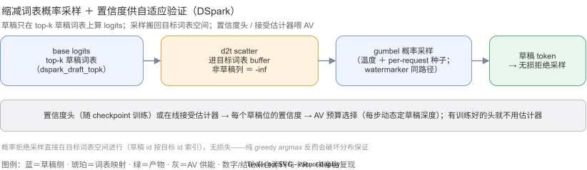

  <a href="/notes/">← 返回学习目录← Back to Study Catalog</a>

  
<strong>解决什么问题：What problem it solves:</strong> EAGLE 这类起草器要带一套独立草稿权重、而且逐 token 串行起草——草稿深度 k 就要 k 次草稿前向，起草时延贵；不串行（如 Medusa 的并行头）则块内 token 互相不知道对方，块一长接受率就掉。EAGLE-style drafters carry separate draft weights and draft strictly left-to-right — depth k costs k draft forwards; parallel heads (Medusa-style) ignore intra-block dependencies, so acceptance collapses as the block grows.

  
<strong>目的是什么：What it is for:</strong> DFlash 把整块起草压成<strong>一次并行前向</strong>（填空式：锚点 + N 个 mask 位同时出预测），DSpark 在这条并行主干上再加一个<strong>轻量 Markov 头</strong>把块内依赖找回来——一次前向出 k 个候选，块内依赖不丢，且整套起草被 CUDA graph 整块捕获。DFlash compresses a whole draft block into one parallel forward (fill-in-the-blank: an anchor plus N mask slots predicted simultaneously); DSpark adds a lightweight Markov head on that parallel backbone to recover intra-block dependencies — k candidates per forward, dependencies intact, with the entire draft step captured in CUDA graphs.

  <strong>先记住四件事TL;DR</strong>
  <ul>
    <li><strong>共同骨架</strong>：把目标模型已有的 hidden states（隐层输出）直接灌进草稿的 KV cache 当上下文，然后 <strong>[锚点 + 预测位] 一个 query 块做一次前向</strong>——整块草稿不逐 token 递归，一次出完。DSpark 的代码直接继承 DFlash 的这套机器（<code>class DSparkSpeculator(DFlashSpeculator)</code>）。</li>
    <li><strong>DFlash（填空式）</strong>：query 布局是 <code>1 + N</code>——锚点位当 bonus token，N 个 mask 位各自<strong>非因果地</strong>（不看彼此、只看上下文）预测自己位置的 token，一次并行采样完事。来自 z-lab 的 DFlash 方法（<a href="https://github.com/vllm-project/vllm/pull/36847">#36847</a>，2026-03）。</li>
    <li><strong>DSpark（半自回归）</strong>：query 布局是 <code>N</code>——锚点位自己预测第 1 个草稿 token，然后一个<strong>轻量 Markov 头</strong>逐位加偏置（<code>logits_i = base_i + markov_bias(embed(上一个采样 token))</code>），把块内依赖注入并行主干。随 DeepSeek-V4-Flash 引入（<a href="https://github.com/vllm-project/vllm/pull/41834">#41834</a>，2026-05），草稿权重折叠进主 checkpoint（self-drafting，k=5）。</li>
    <li><strong>工程三件套</strong>：整套起草步（并行主干 ＋ Markov 循环）被 <strong>FULL CUDA graph</strong> 整块捕获；支持<strong>缩减草稿词表</strong>（<code>dspark_draft_topk</code> ＋ draft→target 映射，概率拒绝采样）；带<strong>置信度头</strong>接自适应验证（AV）。批分片采样下 Markov 循环按 batch 位置分片（本周周报的 #63886）。</li>
  </ul>

<h2 id="先统一几个词">
  先统一几个词
  Terms first
</h2>

<table class="srctable">
  <tbody>
    <tr><td><strong>锚点（anchor）</strong></td><td>query 块的第 0 位：放上一个已确定的 token（上一步采样的 token）。DFlash 里它自己不算预测（当 bonus 交差）；DSpark 里它就是第 1 个预测位</td></tr>
    <tr><td><strong>mask token（填空位）</strong></td><td>预测位上放的占位 token（类似 BERT 的 [MASK]）：非因果注意力下，每个 mask 位只看上下文、不看彼此，同时各自预测</td></tr>
    <tr><td><strong>非因果 / 双向注意力</strong></td><td>non-causal，attention mask 不限制「只能看前面」——填空式起草的前提；不是所有 attention 后端都支持（FA 支持，Triton / FlashInfer TRTLLM 不支持）</td></tr>
    <tr><td><strong>context states</strong></td><td>上下文隐层：目标模型在 prefill / 已接受 token 上算出的 hidden states，直接当草稿的 K/V 上下文用（不再用草稿自己重新算一遍上下文）</td></tr>
    <tr><td><strong>aux hidden states</strong></td><td>目标模型若干中间层的隐层输出，拼接（或均值池化）后喂给草稿模型当输入——与 EAGLE3 的做法同源</td></tr>
    <tr><td><strong>Markov 头</strong></td><td>DSpark 的轻量串行件：<code>markov_embed(上一个采样 token)</code> → <code>markov_bias</code> 投影成一个逐位偏置，加回并行主干的 base logits——只有 embed ＋ 一层投影，重活全在并行主干</td></tr>
    <tr><td><strong>缩减草稿词表</strong></td><td>草稿 logits 只在 top-k 草稿词表上算（<code>dspark_draft_topk</code>），采样前经 draft→target 映射（d2t）scatter 进目标词表 buffer、其余列填 -inf</td></tr>
    <tr><td><strong>自适应验证（AV）</strong></td><td>Adaptive Verification，每步动态决定草稿多少个 token 的机制；DSpark 的置信度头（或在线接受估计器）给它供置信度</td></tr>
    <tr><td><strong>FULL CUDA graph</strong></td><td>整个草稿步（并行主干前向 ＋ Markov 循环采样）作为一个整图捕获回放，消 launch 开销</td></tr>
    <tr><td><strong>PCP</strong></td><td>prefill context parallelism，prefill 上下文并行；批分片 draft logits 目前要求 PCP ＝ 1（见周报 #64151）</td></tr>
  </tbody>
</table>

<h2 id="共同骨架">
  共同骨架：一次并行前向起草一整块
  The shared skeleton: one parallel forward drafts the whole block
</h2>

  <strong>白话版</strong>：普通草稿模型像「接力写」——写第 1 个词、拿结果写第 2 个、再写第 3 个，k 个词要 k 轮。DFlash/DSpark 像「完形填空」——把上下文摆好，一次摆出 k 个空位，<strong>一口气体做完一次前向</strong>，所有空位同时出答案。代价是空位之间互相看不见（DFlash 干脆不管），DSpark 则用一个便宜的小头把「前一个空填了什么」告诉后面的空位。
  Plain version: a regular draft model writes like a relay — token 1, then token 2 from token 1, k rounds for k tokens. DFlash/DSpark work like a fill-in-the-blank exam: lay out k blanks and run one forward pass over all of them at once. The catch is the blanks cannot see each other (DFlash accepts this); DSpark uses a cheap little head to whisper "what the previous blank got" to each subsequent blank.

  <strong>源码版</strong>：每个草稿步分两段。第一段 <strong>context-KV 预计算</strong>：把目标模型的 hidden states（上下文部分）直接写进草稿层的 KV cache——这些状态目标已经算过一遍，草稿不重算；第二段 <strong>query 块前向</strong>：每请求摆出固定个数的 query 位（锚点 ＋ 预测位），做一次（部分非因果的）注意力前向，所有预测位同时产出 logits。两段合起来被 FULL CUDA graph 捕获（<code>dflash/cudagraph.py</code> 的 <code>DFlashCudaGraphManager</code>），查询 buffer 地址固定、context 与 query 分开开缓冲。输入侧与 EAGLE 家族同源：吃目标模型的 aux hidden states（DFlash 走 EAGLE3 式拼接；DSpark 用目标层的均值池化、经 <code>main_proj</code> 折到草稿 hidden size）。
  Source version: each draft step has two stages. Stage 1, context-KV precompute — the target's hidden states for the context are written straight into the draft layers' KV cache (the target already computed them; the drafter does not redo it). Stage 2, a query-block forward — each request lays out a fixed number of query slots (anchor + prediction slots) and one (partially non-causal) attention pass produces logits at every prediction slot simultaneously. Both stages are captured as a FULL CUDA graph (DFlashCudaGraphManager), with stable query-buffer addresses and separate context/query buffers. On the input side it matches the EAGLE family: aux hidden states from the target (EAGLE3-style concatenation for DFlash; mean-pooled and folded through main_proj for DSpark).

  

<h2 id="dflash">
  DFlash：填空式并行起草
  DFlash: fill-in-the-blank parallel drafting
</h2>

  query 布局是 <code>1 + N</code>（N ＝ <code>num_speculative_tokens</code>）：锚点位放上一个采样 token、充当 <strong>bonus token</strong>（bonus ＝ 草稿给的「下一个 token」初值，验证通过时直接收下），后面 N 个 mask 位各自<strong>填空</strong>——非因果注意力让每个 mask 只看上下文与锚点、不看其他 mask，N 个位置的预测互不依赖、<strong>一次并行采样</strong>收工。块内没有任何递归，所以 k 可以开得很大（官方示例 k=15）。代价也在这里：mask 位之间没有依赖，块越长、后面的预测越「盲」，接受率随 k 下降得比自回归草稿快。
  The query layout is 1 + N (N = num_speculative_tokens): the anchor slot holds the last sampled token and serves as the bonus token (bonus = the drafter's initial "next token", taken as-is if verification accepts it), while N mask slots each fill in a blank — non-causal attention lets each mask see only the context and the anchor, never each other, so all N predictions are independent and sampled in one parallel shot. There is no recursion inside the block, so k can be large (the official example uses k=15). The same fact is the cost: mask slots carry no dependency, so acceptance decays with k faster than for autoregressive drafts.

  工程要点：mask 位的非因果注意力只有部分后端支持（FlashAttention 支持；Triton Attention、FlashInfer TRTLLM 不支持），因此 DFlash 模型对 <code>--attention-backend</code> 有约束；草稿批处理也要求 <code>disable_padded_drafter_batch</code>（被拒 token 不能留在批里污染双向计算，不像因果注意力可以简单无视）。DFlash 来自 z-lab 的 <a href="https://github.com/z-lab/dflash">DFlash 方法</a>（<a href="https://github.com/vllm-project/vllm/pull/36847">#36847</a>），论文复现的接受率直接进了 vLLM 的测试套件。
  Engineering notes: only some backends support the mask slots' non-causal attention (FlashAttention yes; Triton Attention and FlashInfer TRTLLM no), so DFlash models constrain --attention-backend; the draft batch also requires disable_padded_drafter_batch (rejected tokens must leave the batch — they would corrupt the bidirectional computation, unlike causal attention where they can simply be ignored). DFlash comes from z-lab's method (#36847); the paper's acceptance rates are reproduced directly in vLLM's test suite.

<h2 id="dspark">
  DSpark：并行主干 ＋ 轻量 Markov 头
  DSpark: parallel backbone + a lightweight Markov head
</h2>

  DSpark 直接继承 DFlash 的机器（<code>class DSparkSpeculator(DFlashSpeculator)</code>），改两件事。<strong>布局改成 <code>N</code> 位、锚点即第 1 个预测位</strong>（<code>sample_from_anchor</code> 路径）：每个 query 位都预测「自己的下一个 token」，采样位置是 <code>query_pos + 1</code>——没有纯交差的 bonus 位，N 个位里没有一个浪费。（Speculators 格式的 checkpoint 仍走 DFlash 的 1+N 填空布局，锚点当 bonus。）
  DSpark inherits DFlash's machinery (class DSparkSpeculator(DFlashSpeculator)) and changes two things. First, the layout becomes N slots with the anchor as the first prediction slot (the sample_from_anchor path): every query slot predicts "the token after itself", sampling at query_pos + 1 — no pure-bonus slot, so none of the N slots is wasted. (Speculators-format checkpoints still use DFlash's 1+N fill-in layout with the anchor as bonus.)

  <strong>第二件是 Markov 头</strong>：并行主干一次前向产出每个位置的 <code>base_logits</code> 后，串行地逐位采样——第 i 位先用 <code>markov_embed(上一个采样 token)</code> 算一个偏置，<code>logits_i = base_logits[:, i] + markov_bias(...)</code>，采出 <code>draft_tokens[:, i]</code>，它又成为第 i+1 位的输入。这样块内依赖回来了，而串行部分只有「token embedding ＋ 一层偏置投影」——<strong>重活（整段上下文的理解）仍在并行主干那一次前向里</strong>。这就是「半自回归并行起草」的含义：块的形状是并行的，块的灵魂（前缀依赖）是串行注入的。整套（主干 ＋ Markov 循环）在 FULL CUDA graph 里；批分片采样下，Markov 循环按 batch 位置分片、每个 TP rank 只跑自己请求（周报 #63886）。
  Second, the Markov head: after the parallel backbone produces base_logits for every slot, sampling goes left-to-right — slot i first computes a bias from the previously sampled token (markov_embed → markov_bias), forms logits_i = base_logits[:, i] + bias, samples draft_tokens[:, i], and that sample feeds slot i+1. The intra-block dependency is back, while the serial part is just a token embedding + one bias projection — the heavy lifting (understanding the whole context) stays in the backbone's single forward. That is "semi-autoregressive parallel drafting": parallel in shape, serial in prefix dependency. The whole thing (backbone + Markov loop) lives in a FULL CUDA graph; under batch-sharded sampling the Markov loop shards by batch position, each TP rank running only its own requests (weekly #63886).

  

<h2 id="缩减词表与自适应">
  缩减词表、概率采样与自适应验证
  Reduced vocab, probabilistic sampling, adaptive verification
</h2>

  <strong>缩减草稿词表</strong>：配置 <code>dspark_draft_topk</code>（≤ 草稿词表大小）时，草稿 logits 只在 top-k 草稿词表上计算；采样前经预计算的 draft→target 映射（d2t）scatter 进一张目标词表 buffer——非草稿列恒为 -inf，草稿列被逐步覆写。这样<strong>概率拒绝采样直接在目标词表空间进行</strong>（草稿 id 按目标 id 索引），无损失且与 watermarker（水印）兼容。<strong>采样本身是概率的</strong>：gumbel 采样（带温度、per-request 种子），不是纯 greedy argmax——配合拒绝采样保持目标分布。注意「随机生成 draft token id」曾是 #41834 分支上修过的 bug，正确实现是 d2t 映射 + scatter。
  Reduced draft vocab: with dspark_draft_topk set (≤ draft vocab size), draft logits are computed only over a top-k draft vocabulary; before sampling they are scattered via a precomputed draft→target map (d2t) into a target-vocab buffer — non-draft columns stay -inf, draft columns overwritten each step. Probabilistic rejection sampling then runs directly in target-vocab space (draft ids indexed by target ids), lossless and watermark-compatible. Sampling is probabilistic (temperatured gumbel with per-request seeds), not plain greedy argmax — paired with rejection sampling it preserves the target distribution.

  <strong>自适应验证（AV）的供能</strong>：DSpark 可以带<strong>置信度头</strong>（confidence head，随 checkpoint 训练），每个草稿位输出置信度、喂给 AV 的预算选择；没有置信度头时退回<strong>在线接受估计器</strong>（online acceptance estimator，用运行中接受频率在线估）。两者的取舍：有训练好的头就不需要估计器（<code>use_acceptance_estimator = False</code>）。本周周报里的 <a href="/notes/vllm/#week-2026-11-03">#64368</a>（草稿 lm_head 量化）正是给这条起草路省钱——共享目标 lm_head 的 DSpark 用 FP8/NVFP4 私有副本算基座 logits。
  Feeding adaptive verification (AV): DSpark can carry a trained confidence head whose per-slot confidences feed AV's budget selection; without one it falls back to an online acceptance estimator (the trained head wins: use_acceptance_estimator = False). This week's #64368 (draft lm_head quantization) cuts cost on exactly this drafting path — the shared-target-lm_head DSpark computes base logits through an FP8/NVFP4 private copy.

  

<h2 id="模型与用法">
  模型家族与用法
  Model family &amp; usage
</h2>

<table class="srctable">
  <thead>
    <tr><th></th><th>DFlash</th><th>DSpark</th></tr>
  </thead>
  <tbody>
    <tr><td>引入</td><td>#36847（2026-03，z-lab 方法）＋ #38300（speculators 格式解析）</td><td>#41834（2026-05，随 DeepSeek-V4-Flash）＋ #63996 重构</td></tr>
    <tr><td>代表模型</td><td>Qwen3-8B（<code>z-lab/Qwen3-8B-DFlash-b16</code>）、Qwen3.5、Granite / GraniteMoe（EAGLE3/DFlash aux hidden states）、Laguna、DFlash2（beam）</td><td>DeepSeek-V4 / V4.1-Flash（草稿折叠进主 checkpoint、取代 MTP）、Qwen3（<code>qwen3_dspark.py</code>）、Kimi-K3（<code>dspark_mla.py</code>）、MiniMax-M3.1(-Flash)</td></tr>
    <tr><td>query 布局</td><td>1 ＋ N（锚点＝bonus）</td><td>N（锚点＝第 1 个预测位）；speculators 格式 ckpt 仍走 1＋N</td></tr>
    <tr><td>块内依赖</td><td>无——一次并行采样</td><td>Markov 头逐位注入</td></tr>
    <tr><td>词表</td><td>草稿全词表</td><td>可选缩减词表（<code>dspark_draft_topk</code> ＋ d2t）</td></tr>
    <tr><td>典型 k</td><td>15（官方示例）</td><td>5（self-drafting block-5）</td></tr>
  </tbody>
</table>

  用法（两条配置都来自对应 PR 正文）：
  Usage (both examples from the PRs):

<pre><code># DFlash：Qwen3-8B ＋ 独立草稿 checkpoint，k=15
vllm serve Qwen/Qwen3-8B \
    --speculative-config '{"method": "dflash", "model": "z-lab/Qwen3-8B-DFlash-b16", "num_speculative_tokens": 15}' \
    --attention-backend flash_attn \
    --max-num-batched-tokens 32768

# DSpark：DeepSeek-V4-Flash，草稿已折叠进主 checkpoint，k=5
vllm serve deepseek-ai/DeepSeek-V4-Flash \
    --speculative-config '{"method": "dspark", "num_speculative_tokens": 5}'</code></pre>

  DFlash 的实测（PR 自测未复现，1×B200，六数据集，k=15）：<strong>并发 1 时加速 2.8–4.6×，并发 8 时 2.1–3.4×，并发 32 时 1.2–2.1×</strong>——低并发（时延敏感）受益最大，高并发下 GPU 本来就满，加速收敛到吞吐比。DSpark（k=5）随 V4-Flash 的定位是「省掉 MTP 头、草稿进主 checkpoint」的单检查点方案，本周周报里的 <a href="/notes/vllm/#week-2026-11-03">#64356 / #63886（批分片第二季）与 #64368（草稿 lm_head 量化）</a>都是围绕它演进的。
  DFlash measurements (PR-reported, not reproduced; 1×B200, six datasets, k=15): at concurrency 1 speedups are 2.8–4.6×, at 8 they are 2.1–3.4×, at 32 they settle to 1.2–2.1× — latency-bound low-concurrency workloads gain most. DSpark (k=5) is V4-Flash's single-checkpoint story (MTP heads removed, drafter folded into the main checkpoint); this week's #64356 / #63886 (batch-sharded sampling S2) and #64368 (draft lm_head quantization) all evolve it.

<h2 id="边界与坑">
  边界与坑
  Boundaries &amp; gotchas
</h2>

<ul>
  <li><strong>非因果后端限制</strong>：填空位需要非因果注意力，后端必须支持（FlashAttention 支持；Triton Attention / FlashInfer TRTLLM 不支持）——DFlash 模型选后端时先查这个。</li>
  <li><strong>被拒 token 必须出批</strong>：双向注意力下被拒 token 的状态会污染其他位，不能像因果注意力那样「无视」，所以 <code>disable_padded_drafter_batch</code> 被强制开启。</li>
  <li><strong>多模态</strong>：DFlash 机器当前不支持多模态输入（<code>supports_mm_inputs = False</code>）。</li>
  <li><strong>批分片的条件</strong>：批分片 draft logits 要求 speculator 支持、无 draft watermarker、PCP ＝ 1；DSpark 的 Markov 循环分片还要求草稿模型没自带 <code>sample_sequential</code> 内核、能算词表分片 logits、PyNCCL 可用——不满足就回退全量复制（代码会 log 原因）。</li>
  <li><strong>speculators 格式 ckpt</strong>：走 DFlash 的 1＋N 布局（锚点＝bonus），与 DSv4-Flash 原生检查点的 N 位 anchor-as-first 不同——同一方法名，布局由 checkpoint 格式决定。</li>
</ul>

<h2 id="源码定位">
  源码定位表
  Source map
</h2>

<table class="srctable">
  <thead>
    <tr><th>机制</th><th>位置</th></tr>
  </thead>
  <tbody>
    <tr><td>DFlash 提案器（调度侧）</td><td><code>vllm/v1/spec_decode/dflash.py: DFlashProposer</code>（context/query 拆分的 Triton kernel 也在这）</td></tr>
    <tr><td>DFlash 执行侧 / FULL graph</td><td><code>vllm/v1/worker/gpu/spec_decode/dflash/{speculator,cudagraph}.py</code></td></tr>
    <tr><td>DSpark（继承 DFlash）</td><td><code>vllm/v1/worker/gpu/spec_decode/dspark/speculator.py</code>（<code>_sample_markov_chain</code>、<code>_sample_sequential_sharded</code>）、<code>config.py</code>（<code>dspark_draft_topk</code> / <code>draft_lm_head_quantization</code>）</td></tr>
    <tr><td>方法注册 / 选项</td><td><code>vllm/transformers_utils/configs/speculators/algos.py</code>；<code>method: "dflash" / "dspark" / "dflash2"</code></td></tr>
    <tr><td>模型实现</td><td><code>vllm/model_executor/models/qwen3_dflash.py</code> / <code>qwen3_dspark.py</code>；<code>vllm/models/deepseek_v41/{nvidia,amd}/dspark.py</code>（fused Markov 内核）；<code>vllm/models/kimi_k3/nvidia/dspark_mla.py</code></td></tr>
  </tbody>
</table>

<em>基于 vLLM main @ 2026-11-03；DSpark/DFlash 仍在快速演进（DFlash2、批分片、AV 集成），以最新源码为准。数字均来自 PR 正文自测，未亲自复现。</em>

