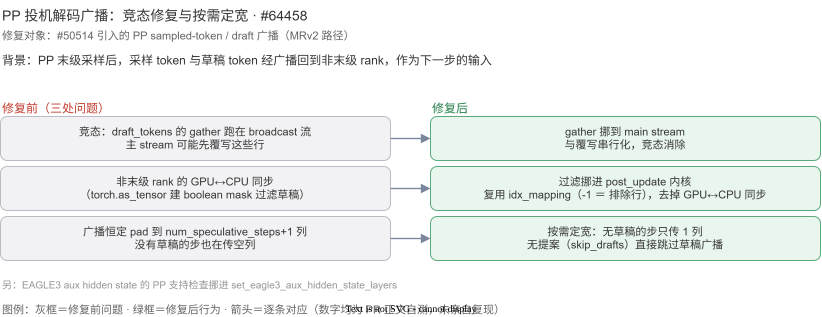
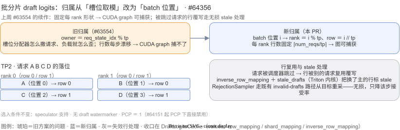
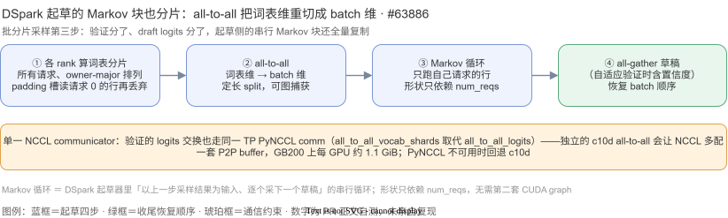
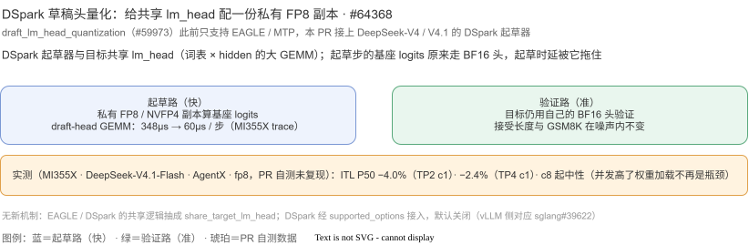
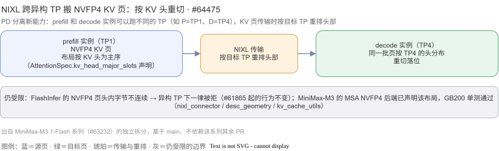
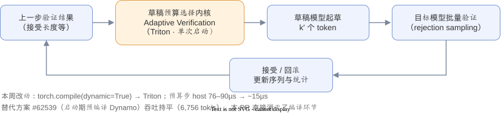
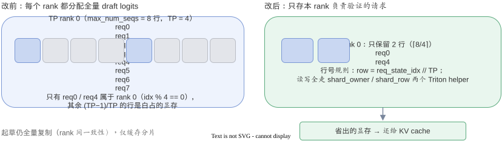
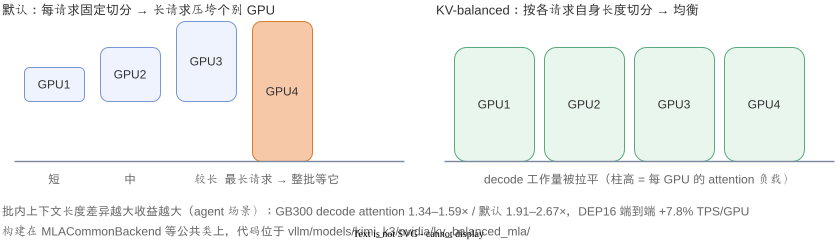
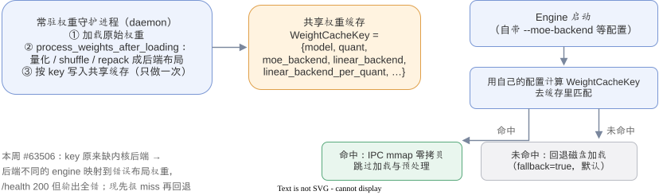

<style>
  .dg { width: 100%; height: auto; display: block; margin: 8px 0 2px; }
  .dg .b  { fill: #eef3fd; stroke: #7a97d4; stroke-width: 1.2; }
  .dg .ba { fill: #fff3e0; stroke: #e0a04a; stroke-width: 1.4; }
  .dg .bg { fill: #e9f6ee; stroke: #59a97c; stroke-width: 1.2; }
  .dg .bb { fill: #f2f2f4; stroke: #b9bcc4; stroke-width: 1; }
  .dg text { fill: #333; font-family: inherit; }
  .dg .ts { fill: #666; }
  .dg .ln { stroke: #7a879d; stroke-width: 1.4; fill: none; }
  .dg .arrp { fill: #7a879d; }
  .dg .cell  { fill: #c9d7f2; stroke: #7a97d4; }
  .dg .cellx { fill: #e3e5ea; stroke: #b9bcc4; }
  .dg .hi    { fill: #f7c8a8; stroke: #d97c2b; }
  html[data-theme="dark"] .dg .b  { fill: #2b3550; stroke: #6f8cc9; }
  html[data-theme="dark"] .dg .ba { fill: #41321b; stroke: #d9a04b; }
  html[data-theme="dark"] .dg .bg { fill: #1f3a2a; stroke: #5cb987; }
  html[data-theme="dark"] .dg .bb { fill: #2c2f36; stroke: #565b66; }
  html[data-theme="dark"] .dg text { fill: #ddd; }
  html[data-theme="dark"] .dg .ts { fill: #999; }
  html[data-theme="dark"] .dg .ln { stroke: #8a97ad; }
  html[data-theme="dark"] .dg .arrp { fill: #8a97ad; }
  html[data-theme="dark"] .dg .cell  { fill: #3b4a75; stroke: #6f8cc9; }
  html[data-theme="dark"] .dg .cellx { fill: #33363d; stroke: #565b66; }
  html[data-theme="dark"] .dg .hi    { fill: #5c3a1e; stroke: #e08b3d; }
  details.prwiki {
    border: 1px solid #ddd; border-radius: 8px; padding: 10px 16px;
    margin: 16px auto; max-width: 800px; background: #fff;
  }
  html[data-theme="dark"] details.prwiki { border-color: #444; background: #26282c; }
.diagram-fig { background:#fff; border:1px solid #ddd; border-radius:8px; padding:12px; margin:10px auto; max-width:860px; }
.diagram-fig img { width:100%; height:auto; display:block; }
html[data-theme="dark"] .diagram-fig { border-color:#444; }
.wk-why { font-size:0.9rem; color:#555; border-left:3px solid #7a97d4; padding:2px 0 2px 10px; margin:8px 0 10px; }
html[data-theme="dark"] .wk-why { color:#aaa; border-left-color:#6f8cc9; }
</style>

<p>
  <a href="/notes/"><span class="i18n-zh">← 返回学习笔记</span><span class="i18n-en">← Back to Study Notes</span></a>
</p>

<div class="i18n-en">
  <p><em>English quick summary: this page is a <strong>weekly tracker of upstream vLLM mechanisms</strong> — each week I read the newly merged PRs, pick the interesting mechanisms, and explain them in Chinese with a structure diagram and PR links. This week (2026-10-27 → 11-03): PP speculative-decode broadcast fixes in MRv2, the batch-position ownership refactor for sharded draft logits plus DSpark sequential-block sharding, a quantized draft lm_head for DSpark, and NIXL KV-head re-sharding for heterogeneous-TP P/D transfers. (Diagrams are labeled in Chinese.)</em></p>
</div>

<h2 id="追踪说明">
  <span class="i18n-zh">追踪说明</span>
  <span class="i18n-en">How this tracker works</span>
</h2>

<ul>
  <li><span class="i18n-zh"><strong>每周一篇</strong>：覆盖最近 7 天（UTC）合入的 PR，最新的一期放最上面；往期归档在页底。</span></li>
  <li><span class="i18n-zh"><strong>来源</strong>：vllm-project/vllm 的 merged PR，按标题 + 正文人工筛选；每个机制都附 PR 链接，可溯源。</span></li>
  <li><span class="i18n-zh"><strong>筛选标准</strong>：新机制 / 性能机制优先；bugfix 只挑影响面大的；CI / 文档类只在快讯里带一句。</span></li>
  <li><span class="i18n-zh"><strong>图</strong>：每个机制配一张结构图（SVG，适配深色模式）；图与文中的数字均来自 PR 正文的自测数据，我未亲自复现。</span></li>
</ul>

<h2 id="week-2026-11-03">
  <span class="i18n-zh">本周：2026-10-27 → 11-03</span>
  <span class="i18n-en">This week: 2026-10-27 → 11-03</span>
</h2>

<p>
  <span class="i18n-zh">窗口内合入 533 个 PR。本周<strong>投机解码</strong>持续刷屏：上周的批分片采样出了两集续作（归属重构 ＋ DSpark 起草块分片），PP 的草稿/采样广播补上竞态与同步，草稿 lm_head 也接上了量化；另有一条 PD 分离的 KV 页面跨 TP 重切。这些机制会进 v0.32.0（10-18 发布）之后的下一个 release。</span>
</p>

<h3 id="pp-broadcast-fix">1 · PP 投机解码广播：竞态、同步与空列三处修复 · <a href="https://github.com/vllm-project/vllm/pull/64458">#64458</a></h3>

<p class="wk-why">
  <span class="i18n-zh"><strong>解决什么问题：</strong>PP 下草稿/采样 token 的广播跑在多条 CUDA 流上，流序错了会读到被覆写的行——输出悄悄出错；非末级 rank 还有 GPU↔CPU 同步拖节奏、恒定 padding 的空列浪费带宽。<strong>目的是什么：</strong>把流序修正、同步去掉、广播按需定宽，让 PP＋投机解码的广播既正确又省。</span>
</p>

<p>
  <span class="i18n-zh">本 PR 修 <code>#50514</code> 引入的 sampled-token / draft 广播：① <strong>竞态修复</strong>——草稿更新时从共享 <code>req_states.draft_tokens</code> buffer 做 gather 原来跑在 broadcast stream 上，主 stream 可能先覆写这些行，gather 挪回 main stream 串行化；② <strong>去掉非末级 rank 的 GPU↔CPU 同步</strong>——原来用 <code>torch.as_tensor</code> 建 boolean mask 过滤收到的草稿，现在挪进 post_update 内核、复用 <code>idx_mapping</code>（-1 ＝ 排除行）；③ <strong>按需广播</strong>——本步没有草稿提案（skip_drafts）就直接跳过草稿广播，并改由「本步是否广播了采样 token」来门控；④ <strong>按需定宽</strong>——采样 token 广播按本步实际宽度开（无草稿 1 列），不再固定 pad 到 <code>num_speculative_tokens+1</code>；⑤ EAGLE3 aux hidden state 的 PP 支持检查挪进 <code>set_eagle3_aux_hidden_state_layers</code>。</span>
</p>

<div class="diagram-fig">
  
</div>

<h3 id="sharded-draft-s2">2 · 批分片采样第二季：归属按 batch 位置、DSpark 起草块也分片 · <a href="https://github.com/vllm-project/vllm/pull/64356">#64356</a> ＋ <a href="https://github.com/vllm-project/vllm/pull/63886">#63886</a></h3>

<p class="wk-why">
  <span class="i18n-zh"><strong>解决什么问题：</strong>上周 #63554 的按槽位归属让 rank 负载跟着槽位分配器漂、每 rank 行数每步在变（CUDA graph 捕不了）；DSpark 的 Markov 起草块还全量复制，每 rank 算全词表、采所有请求。<strong>目的是什么：</strong>改成按 batch 位置归属——形状固定、图可捕获——并把起草侧沿同一规则分片。</span>
</p>

<p>
  <span class="i18n-zh"><strong>#64356（归属重构）</strong>：归属从 <code>req_state_idx % tp_size</code> 改为 <strong>batch 位置 i</strong>——rank ＝ <code>i % tp_size</code>、row ＝ <code>i // tp_size</code>，每 rank 至多 ⌈num_reqs/tp⌉ 行、形状只依赖批大小，现有草稿 CUDA graph 直接捕获。缓存与三个映射表（<code>row_mapping / shard_mapping / inverse_row_mapping</code>）收口进新对象 <code>DraftLogitsCache</code>。一个细节：行是每步重排的，被调度器跳过的请求会发现自己的行被覆写——<code>stale_drafts</code>（Triton 内核）把换了主的行标 stale，RejectionSampler 走既有 invalid-drafts 路径<strong>从目标分布重采</strong>，无损，只降那一步的接受率。选入条件不变：speculator 支持、无 draft watermarker、PCP ＝ 1（PCP 下的越界 bug 由 #64151 直接禁用兜住）。</span>
</p>

<div class="diagram-fig">
  
</div>

<p>
  <span class="i18n-zh"><strong>#63886（DSpark 起草块分片）</strong>：把 DSpark 的串行 Markov 块沿同一归属规则分片，四步走：① 各 rank 给所有请求算词表分片的基座 draft logits（owner-major 排列，padding 槽读请求 0 的行再丢弃）；② <strong>all-to-all 把分片从词表维重切成 batch 维</strong>——每个 rank 拿到自己请求的全词表 logits；③ Markov 循环只跑自己请求的行；④ all-gather 草稿（自适应验证时含置信度）恢复 batch 顺序。所有形状只依赖 <code>num_reqs</code>，不用第二套 CUDA graph。通信上收敛到<strong>单一 PyNCCL communicator</strong>：验证的 logits 交换也走同一条 TP comm（<code>all_to_all_vocab_shards</code> 取代 <code>all_to_all_logits</code>）——独立 c10d all-to-all 会让 NCCL 多配一套 P2P buffer，GB200 上每 GPU 约 1.1 GiB；PyNCCL 不可用时回退 c10d。</span>
</p>

<div class="diagram-fig">
  
</div>

<h3 id="dspark-lmhead-quant">3 · DSpark 草稿头量化：共享 lm_head 配私有 FP8 副本 · <a href="https://github.com/vllm-project/vllm/pull/64368">#64368</a></h3>

<p class="wk-why">
  <span class="i18n-zh"><strong>解决什么问题：</strong>共享目标 lm_head 的起草器，每步基座 logits 都要过一遍 BF16 大 GEMM（词表 × hidden），起草时延被它拖住。<strong>目的是什么：</strong>草稿头用 FP8/NVFP4 私有副本算基座 logits，目标验证仍用自己的 BF16 头——起草提速而精度路径不动。</span>
</p>

<p>
  <span class="i18n-zh"><code>draft_lm_head_quantization</code>（<a href="https://github.com/vllm-project/vllm/pull/59973">#59973</a>）此前只支持 EAGLE / MTP，本 PR 把 DeepSeek-V4 / V4.1 的 DSpark 起草器接上（对应 sglang#39622 的 vLLM 实现）：<code>--speculative-config '{"method": "dspark", "num_speculative_tokens": 5, "draft_lm_head_quantization": "fp8"}'</code>。实测（MI355X · DeepSeek-V4.1-Flash · AgentX，PR 自测未复现）：draft-head GEMM <strong>348µs → 60µs / 步</strong>；ITL P50 在 TP2 c1 <strong>−4.0%</strong>、TP4 c1 −2.4%，c8 起中性；接受长度与 GSM8K 在噪声内不变——因为验证仍用目标自己的头。实现上没有新机制：EAGLE / DSpark 共享 lm_head 的逻辑抽成 <code>share_target_lm_head</code> 一个 helper，DSpark 经 <code>DSparkSpeculatorConfig.supported_options</code> 接入，默认关闭。</span>
</p>

<div class="diagram-fig">
  
</div>

<h3 id="nixl-hetero-tp">4 · NIXL 跨异构 TP 搬 NVFP4 KV 页：按 KV 头重切 · <a href="https://github.com/vllm-project/vllm/pull/64475">#64475</a></h3>

<p class="wk-why">
  <span class="i18n-zh"><strong>解决什么问题：</strong>PD 分离里 prefill 和 decode 常想用不同 TP（P=TP1 省通信、D=TP4 提吞吐），但 KV 页布局沿 TP 切，页面不兼容就传不了——NVFP4 页此前在异构 TP 下一律被拒。<strong>目的是什么：</strong>对「按 KV 头为主序」布局的页，NIXL 传输时按目标 TP 重排头部，异构 TP 的 KV 复用打通。</span>
</p>

<p>
  <span class="i18n-zh">当 attention spec 声明页面按 KV head 布局（<code>AttentionSpec.kv_head_major_slots</code>）时，NIXL 即可在异构 TP 间重切搬运；MiniMax-M3 的 MSA NVFP4 后端已声明该布局，FlashInfer 的 NVFP4 页因为头内字节不连续仍被拒（#61865 行为不变）。GB200 单测通过（nixl_connector / desc_geometry / kv_cache_utils）。该 PR 出自 MiniMax-M3.1-Flash 系列（<a href="https://github.com/vllm-project/vllm/pull/63232">#63232</a>）的独立拆分。</span>
</p>

<div class="diagram-fig">
  
</div>

<h3 id="quick-hits-w2">
  <span class="i18n-zh">快讯</span>
  <span class="i18n-en">Quick hits</span>
</h3>

<ul>
  <li><strong>批分片 ＋ PCP 不兼容</strong>：<a href="https://github.com/vllm-project/vllm/pull/64151">#64151</a> — 批分片 draft logits 在 PCP（prefill 上下文并行）下禁用：PCP 用 req_state_idx 索引、没算分片偏移，先关掉保正确。</li>
  <li><strong>草稿侧省显存</strong>：<a href="https://github.com/vllm-project/vllm/pull/64612">#64612</a> — GLM5.3：草稿模型切 dlfash FP8 KV cache，每 rank 省 2.85 GB。</li>
  <li><strong>PP ＋ KV 传输</strong>：<a href="https://github.com/vllm-project/vllm/pull/64733">#64733</a> — MiniMax-M3.1 PP 优化：NIXL 从 PP prefill stage 拉 KV（pull 模式）＋ SM10x 上 Q8KV4 prefill workspace。</li>
  <li><strong>前缀缓存 ＋ 滑窗</strong>：<a href="https://github.com/vllm-project/vllm/pull/64094">#64094</a> — ROCm DSv4.1 在 gfx950 开 prefix-cache SWA replay（滑窗注意力的前缀缓存重放）。</li>
  <li><strong>TP ＋ MegaMoE</strong>：<a href="https://github.com/vllm-project/vllm/pull/64659">#64659</a> — MiniMax-M3：序列并行 ＋ GEMM-RS（reduce-scatter 融进 GEMM）；<a href="https://github.com/vllm-project/vllm/pull/64852">#64852</a> — fused norm+quant MXFP8（NVIDIA）。</li>
</ul>

<h2 id="archive">
  <span class="i18n-zh">往期周报</span>
  <span class="i18n-en">Past weeks</span>
</h2>

<details class="prwiki" markdown="1">
<summary><strong><span class="i18n-zh">第 1 期 · 2026-10-20 → 10-27</span><span class="i18n-en">Issue 1 · 2026-10-20 → 10-27</span></strong>（<span class="i18n-zh">AV 预算选择内核化 · 批分片 draft logits · Kimi-K3 KV 均衡 MLA · Fast Start 缓存 key —— 点开展开</span><span class="i18n-en">AV Triton-ization, batch-sharded draft logits, Kimi-K3 KV-balanced MLA, Fast Start cache key</span>）</summary>

<h2 id="week-2026-10-27">
  <span class="i18n-zh">本周：2026-10-20 → 10-27</span>
  <span class="i18n-en">This week: 2026-10-20 → 10-27</span>
</h2>

<p>
  <span class="i18n-zh">窗口内合入 500+ 个 PR（拉取上限 500，实际更多）。本周焦点是<strong>投机解码</strong>：自适应验证的性能与显存各补了一块。版本背景：<a href="https://github.com/vllm-project/vllm/releases/tag/v0.32.0">v0.32.0</a> 已于 10-18 发布，下面这些机制会进下一个 release。</span>
</p>

<h3 id="av-triton">1 · 自适应验证的「草稿预算选择」内核化 · <a href="https://github.com/vllm-project/vllm/pull/63421">#63421</a></h3>

<p class="wk-why">
  <span class="i18n-zh"><strong>解决什么问题：</strong>投机解码每步「草稿多少个」的选择逻辑会在 serving 中途现场编译，卡住进程还拖慢每步调度。<strong>目的是什么：</strong>把这段选择逻辑变成 warmup 时一次性编译的 Triton 内核——运行时不再编译，每步 host 开销大降。</span>
</p>

<p>
  <span class="i18n-zh"><strong>自适应验证（Adaptive Verification, AV）</strong>是投机解码里每步<strong>动态决定草稿多少个 token</strong>的机制：预算 k′ 随上一步的接受情况变化，而不是固定草稿深度。问题在于预算选择原来用 <code>torch.compile(dynamic=True)</code> 实现——serving 中途会现场编译 4–5 个 Dynamo 图（每进程卡 1.8–4.7 秒），且每个预算绑定步的 host 开销高达 76–90µs。本 PR 把预算选择换成<strong>单次启动的 Triton 内核</strong>（Triton＝用 Python 写 GPU kernel 的编译工具），warmup（预热）时一次性 JIT（即时编译）：serving 中不再有编译，host 开销 ~15µs（约 6×），GPU 端 85–100µs → 22–30µs。实测 Qwen3-4B + DSpark（一种草稿模型方案）、GSM8K 数据集、并发 16（H200）：4,783 → 6,803 tok/s（每秒生成 token 数；+42%），精度不变。</span>
</p>

<div class="diagram-fig">
  
</div>

<h3 id="sharded-draft-logits">2 · 批分片采样下，draft logits 缓存也跟着分片 · <a href="https://github.com/vllm-project/vllm/pull/63554">#63554</a></h3>

<p class="wk-why">
  <span class="i18n-zh"><strong>解决什么问题：</strong>批分片采样下每个 rank 只服务 1/TP 的请求，draft logits 缓存却仍按全量行数分配，显存大头被白占。<strong>目的是什么：</strong>让各 rank 只为自己拥有的请求分配 draft logits，把省下的显存还给 KV cache。</span>
</p>

<p>
  <span class="i18n-zh">vLLM 正在推进<strong>批分片采样（batch-sharded sampling）</strong>：目标模型的 logits 沿请求维分片到各 TP rank，请求按 <code>req_state_idx % tp_size</code> 归属，每个 rank 只对<strong>自己拥有的请求</strong>做采样与投机验证。但草稿模型的 logits 缓存此前仍按全量 <code>max_num_seqs</code> 行在每个 rank 上分配——批分片下每 rank 实际只用到 1/TP，其余全是白占的显存。本 PR 让每个 rank 只为自己要验证的请求分配 draft logits：行数 <code>max_num_seqs → ⌈max_num_seqs/tp⌉</code>，起草仍全量复制（保证 rank 间一致），读写统一走 <code>shard_owner / shard_row</code> 两个 Triton helper（单 TP 时编译退化回原行为）；省出的显存直接还给 KV cache。</span>
</p>

<div class="diagram-fig">
  
</div>

<h3 id="kv-balanced-mla">3 · Kimi-K3「按请求长度均衡」的 FP8 MLA decode · <a href="https://github.com/vllm-project/vllm/pull/63638">#63638</a></h3>

<p class="wk-why">
  <span class="i18n-zh"><strong>解决什么问题：</strong>agent 负载同批请求的上下文长短悬殊，decode attention 负载失衡，整批被最长的请求拖住。<strong>目的是什么：</strong>按每个请求自身的长度比例切分它的 KV，让各 GPU 的 decode 工作量重新均衡。</span>
</p>

<p>
  <span class="i18n-zh">Agent 类负载的特点是<strong>同一批里请求的上下文长度差异极大</strong>（有的刚开头、有的已经滚了几万 token），decode attention 的负载随之失衡，整批被最长的请求拖住。新后端 <code>--attention-backend KIMI_K3_KV_BALANCED_MLA</code>（Blackwell，opt-in）按<strong>每个请求自身的长度比例</strong>切分它的 KV，让各 GPU 的 decode 工作量重新均衡。实测（GB300，AgentX 长度分布）：decode attention 相对 TOKENSPEED_MLA（min_split_kv=8）1.34–1.59×、相对其默认配置 1.91–2.67×；端到端 DEP16 decode（3P1D）：+7.8% TPS/GPU、p90 交互时延改善 20%。</span>
</p>

<div class="diagram-fig">
  
</div>

<h3 id="fast-start-cache-key">4 · Fast Start：权重缓存 key 补上「内核后端」维度 · <a href="https://github.com/vllm-project/vllm/pull/63506">#63506</a></h3>

<p class="wk-why">
  <span class="i18n-zh"><strong>解决什么问题：</strong>权重缓存的 key 没记录内核后端，不同后端的 engine 可能错拿布局不对的预处理权重——输出全错还不报错。<strong>目的是什么：</strong>把后端维度补进缓存 key，不匹配就回退磁盘加载，保证拿到的权重一定是自己后端的布局。</span>
</p>

<p>
  <span class="i18n-zh"><strong>Fast Start</strong>（路线图 <a href="https://github.com/vllm-project/vllm/pull/56049">#56049</a>）的思路：由常驻守护进程（daemon）把权重<strong>预处理一次</strong>（<code>process_weights_after_loading</code>：量化、shuffle、repack 成所选内核后端的布局），后续 engine 启动直接走 IPC 共享内存映射，跳过加载与预处理。坑在于：<code>WeightCacheKey</code> 里没有 <code>--moe-backend / --linear-backend</code>——daemon 用 CUTLASS 布局处理好的权重，可能被一个解析成 TRT-LLM 后端的 engine 映射走，<code>/health</code> 照样 200，但<strong>每个输出都是错的</strong>。本 PR 把 <code>moe_backend、linear_backend、linear_backend_per_quant</code> 加进 key（取「配置值」而非「解析值」，保守策略），后端不匹配时先报 key miss，再按默认 <code>fallback=true</code> 回退磁盘加载。</span>
</p>

<div class="diagram-fig">
  
</div>

<h3 id="quick-hits">
  <span class="i18n-zh">快讯</span>
  <span class="i18n-en">Quick hits</span>
</h3>

<ul>
  <li><strong>MRv2（Model Runner V2）<span class="i18n-zh">基建</span></strong>：<a href="https://github.com/vllm-project/vllm/pull/63633">#63633</a> — StagedWriteTensor 按<strong>引用 staging + UVA 直读</strong>：numpy / array.array 零拷贝进 UVA buffer，写内核对 GPU 侧目标也走 UVA，mrope positions 的 stage+apply 从 4–13ms 降到 ~65µs（GB200）。</li>
  <li><strong>KV Offload P2P 提速失败判定</strong>：<a href="https://github.com/vllm-project/vllm/pull/63781">#63781</a> — 卡死对端的故障判定从 ~40s 压到 ~15s（symmetric-P2P load 30→10s、abort-ack 10→5s、lookup 无进展 30→8s；PD 负载保留 30s 给完整 prefill），失败后本地重算。</li>
  <li><strong>Rust 前端对齐周</strong>：<a href="https://github.com/vllm-project/vllm/pull/63313">#63313</a>–<a href="https://github.com/vllm-project/vllm/pull/63318">#63318</a> 等 8+ 个 PR，把 Rust 版 API server 的行为逐项对齐 Python 前端（bad words、logit_bias 校验、LoRA、Mooncake 指标……）。</li>
  <li><strong>退役</strong>：结构化输出后端 <strong>LM Format Enforcer</strong> 被弃用（<a href="https://github.com/vllm-project/vllm/pull/63423">#63423</a>）；实验性的 <strong>vLLM IR</strong> 开始做移除前的清理（<a href="https://github.com/vllm-project/vllm/pull/63371">#63371</a>）。</li>
  <li><strong>生态</strong>：NIXL（NVIDIA 的 KV 传输库）升 1.5.1（<a href="https://github.com/vllm-project/vllm/pull/63817">#63817</a>）；DeepGEMM MegaMoE、AgentX 调优 preset（AgentX＝官方部署调优预设体系；preset / recipe＝针对「模型 × 硬件」预先调好的参数组合；Kimi-K3 / DeepSeek-V4.1 / MiniMax-M3 等型号持续更新）。</li>
</ul>

</details>

<details class="prwiki" markdown="1">
<summary><strong><span class="i18n-zh">背景速览</span><span class="i18n-en">Background primer</span></strong>（<span class="i18n-zh">PagedAttention / 连续批处理 / 架构 / 常用参数 / 学习路线 —— 点开查看</span><span class="i18n-en">PagedAttention, continuous batching, architecture, parameters, learning path</span>）</summary>

### 一句话定位

vLLM 由 UC Berkeley 开源，凭借 <strong>PagedAttention</strong> 一战成名，是目前工业界应用最广的开源 LLM 推理引擎之一，主打高吞吐服务（throughput-oriented serving）。

### 核心机制

- <strong>PagedAttention（SOSP 2023）</strong>：把 KV cache 切成固定大小的 block（典型 16 token/块），用「逻辑块 → 物理块」映射表分页管理、按需分配，几乎消灭显存碎片（论文数据：KV 显存浪费从 60–80% 降到 4% 以下）；序列间相同前缀通过 copy-on-write 共享物理块。
- <strong>Continuous batching（连续批处理）</strong>：调度粒度是引擎的每一步（iteration 级）：请求随到随进批、做完立刻退出、空位马上补新请求。思路源自 Orca。
- <strong>Automatic Prefix Caching（APC）</strong>：对每个 KV block 按内容哈希，相同前缀的请求直接复用已算好的 KV（新版本默认开启）。
- <strong>Chunked prefill</strong>：超长 prompt 的 prefill 切成多个 chunk 与 decode 混批，避免一个长请求阻塞其他请求的时延。
- <strong>投机解码</strong>：内置 ngram、draft model、Medusa、EAGLE、DSpark、DFlash 等方案，以及自适应验证（AV）等增强——本页周报持续追踪这块。
- <strong>量化与并行</strong>：FP8/INT8/AWQ/GPTQ/NVFP4/MXFP8 等量化；TP/PP/EP/DP（张量 / 流水线 / 专家 / 数据并行）与 PD（prefill/decode）分离等（以官方文档为准）。

### 架构与源码入口（V1 引擎）

- <code>AsyncLLM</code>：异步 API 层；<code>EngineCore</code>：独立引擎进程，主循环 = schedule → execute → update。
- <code>Scheduler</code>（<code>vllm/v1/core/sched/</code>）：每步决定哪些请求进批、分配/回收哪些 block。
- <code>Executor / Worker / ModelRunner</code>：多进程执行；GPU 侧负责前向、采样与 CUDA Graph 捕获（MRv2 正在重构这一层）。
- <code>vllm/entrypoints/openai/</code>：OpenAI 兼容 API server。

### 上手与常用参数

```bash
pip install vllm
# 启动 OpenAI 兼容服务
vllm serve Qwen/Qwen2.5-7B-Instruct --tensor-parallel-size 2 --max-model-len 32768
# 压测（新版本）：vllm bench serve；旧版本用仓库内 benchmarks/benchmark_serving.py
```

| <span class="i18n-zh">参数</span><span class="i18n-en">Parameter</span> | <span class="i18n-zh">作用</span><span class="i18n-en">Effect</span> |
| --- | --- |
| `--tensor-parallel-size` | 张量并行卡数 |
| `--gpu-memory-utilization` | 显存占用上限（KV cache 预算由此而来） |
| `--max-model-len` / `--max-num-seqs` | 最大上下文 / 最大并发序列 |
| `--enable-prefix-caching` | 前缀缓存（新版本默认开启） |
| `--speculative-config` | 投机解码配置（方法/草稿模型/步长等） |
| `--attention-backend` / `--moe-backend` | 选择 attention / MoE 内核后端（本周 #63638、#63506 都和它有关） |

### 学习路线

1. 精读 PagedAttention 论文（SOSP 2023）。
2. 本地跑通 serve + 压测（<code>vllm bench serve</code>），观察 TTFT / ITL / 吞吐的相互制约。
3. 读 <code>vllm/v1/core/sched/</code> 调度器源码，跟一遍「一个请求的一生」。
4. 对照本页周报，挑一个新机制去源码里找实现——周报里的 PR 号就是入口。

### 论文与资料

- <em>Efficient Memory Management for Large Language Model Serving with PagedAttention</em>（SOSP 2023）
- 官方文档：docs.vllm.ai；release notes（双周节奏）

</details>

<p><em><span class="i18n-zh">追踪窗口 2026-10-20 → 10-27（UTC）；文中数字来自各 PR 正文自测，未亲自复现。引擎迭代快，以官方文档为准。</span></em></p>
